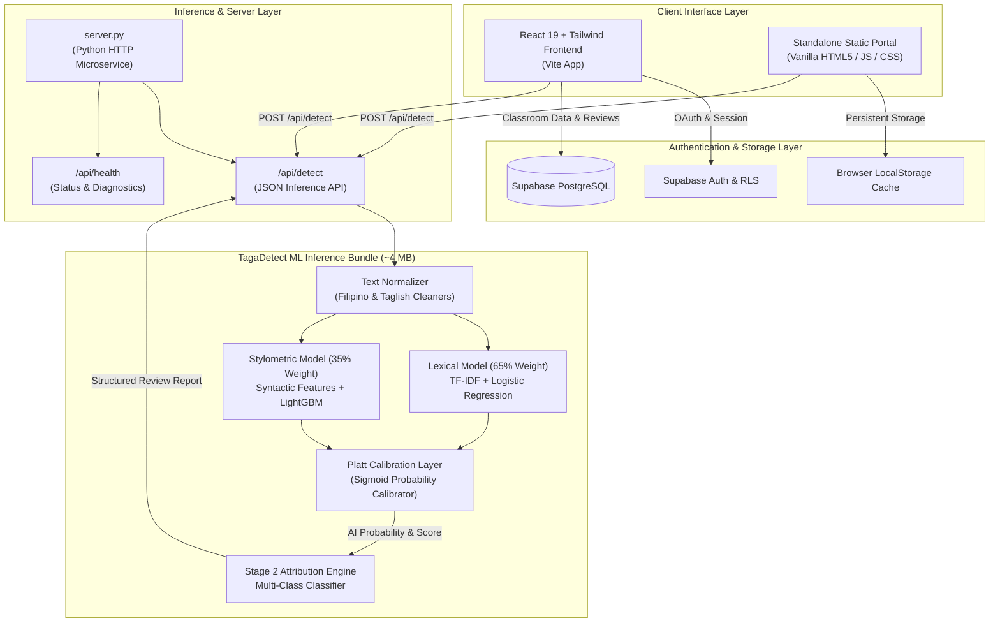

# 🛡️ TagaDetect - Multilingual AI Text Detection & Classroom Integrity Ecosystem

[](https://python.org)
[](https://react.dev)
[](https://vitejs.dev)
[](https://tailwindcss.com)
[](https://scikit-learn.org)
[](https://lightgbm.readthedocs.io)
[](https://supabase.com)
[]()
[]()

> **TagaDetect** is an academic integrity ecosystem and diagnostic classroom platform built specifically for Philippine higher education. It features a high-performance, calibrated dual-model ensemble that detects AI-generated text across **English**, **Filipino**, and code-switched **Taglish**, attributes the likely generative model family, and presents transparent, non-punitive diagnostic reports to both students and professors.

---

## 📑 Table of Contents

- [Overview & Purpose](#-overview--purpose)
- [System Architecture](#-system-architecture)
- [Machine Learning Pipeline](#-machine-learning-pipeline)
  - [Model Performance](#-model-performance-locked-418-sample-test-set)
  - [Why RoBERTa Was Removed](#-architectural-decision-why-roberta-was-removed)
- [Key Features](#-key-features)
  - [Classroom Portal](#1-classroom-portal-lms)
  - [Automated AI Review Pipeline](#2-automated-ai-review-pipeline)
  - [Interactive Detector Playground](#3-interactive-detector-playground)
  - [Governance & Admin Controls](#4-governance--administrative-controls)
- [Project Structure](#-project-structure)
- [Quick Start Guide](#-quick-start-guide)
  - [Prerequisites](#prerequisites)
  - [Option A: Full Modern Stack (React + Python Backend)](#option-a-full-modern-stack-react--python-backend)
  - [Option B: Standalone Portable App (Static HTML + Python Server)](#option-b-standalone-portable-app-static-html--python-server)
- [API Reference](#-api-reference)
- [Deployment Guide](#-deployment-guide)
  - [Deploying the Frontend (Vercel / Netlify)](#1-deploying-the-frontend-vercel--netlify)
  - [Deploying the Inference Backend (Render / Railway / VPS)](#2-deploying-the-inference-backend-render--railway--vps)
- [License & Authors](#-license--authors)

---

## 🎯 Overview & Purpose

The rapid rise of Large Language Models (LLMs) presents acute challenges for academic writing evaluation, particularly in multilingual Southeast Asian environments where students fluidly switch between **English**, **Filipino**, and **Taglish**. Existing commercial AI detectors:
1. Suffer from high **false-positive rates on non-native English writing** and bilingual text.
2. Completely fail or generate erratic confidence scores when evaluating **pure Tagalog** or **Taglish** essays.
3. Act as opaque, punitive "black boxes" that foster distrust between instructors and students.

**TagaDetect** solves this with a **dual-stage, transparent architecture**:
- **Stage 1 (Binary Detection)**: Identifies whether a text is authentically human-authored or AI-generated, optimized specifically to keep **Human False Positive Rate (FPR) low (5.43%)**.
- **Stage 2 (Source Attribution)**: Predicts the generative family (Claude, GPT-4, LLaMA, Gemini, Cohere, etc.) with calibrated probabilities.
- **Shared Diagnostic Reports**: Students and faculty see the exact same sentence-by-sentence breakdown, lexical perplexity, and burstiness cadence, enabling educational discussions rather than punitive accusations.

---

## 🏗️ System Architecture



---

## 🧠 Machine Learning Pipeline

The production pipeline utilizes a lightweight, battle-tested **2-Model Calibrated Ensemble** engineered to prevent overfitting and eliminate text-length shortcuts.

1. **Pre-processing & Text Normalization**:
   - Shared text cleanup removing template artifacts, zero-width spaces, and punctuation anomalies.
   - Dynamic length capping: stylometric indicators are evaluated over bounded token spans to eliminate length-confounding artifacts.
2. **Lexical Sub-Model (65% Ensemble Weight)**:
   - Word & character n-gram TF-IDF vectorizer (`max_features=2500`).
   - L2-regularized Logistic Regression calibrated against vocabulary distributions in English, Filipino, and Taglish.
3. **Stylometric Sub-Model (35% Ensemble Weight)**:
   - Structural feature extraction: character entropy, word length variance, uppercase ratio, sentence length cadence, punctuation density, and lexical richness.
   - Tightened LightGBM Classifier (`max_depth=4`, `num_leaves=12`, `min_child_samples=35`).
4. **Platt Probability Calibration**:
   - Ensemble predictions are calibrated on an independent validation set using Platt scaling (`coef=2.9399`, `intercept=-0.2756`) to ensure predicted probabilities match empirical error rates.
5. **Stage 2 Generator Attribution**:
   - Multi-class classifier activated when Stage 1 indicates AI generation, reporting model family attribution with confidence gating (minimum 35% threshold).

---

### 📊 Model Performance (Locked 418-Sample Test Set)

Evaluated on an untouched, held-out test split (184 Human samples, 234 AI samples):

| Metric | Score | Significance |
|:---|:---:|:---|
| **ROC-AUC** | **0.9847** | Near-perfect discriminative capability across all threshold curves |
| **Accuracy** | **92.34%** | Overall test set correctness |
| **Precision** | **95.50%** | When flagged as AI, 95.5% probability of true AI authorship |
| **Recall (Sensitivity)** | **90.60%** | Catches 90.6% of generated passages |
| **F1-Score** | **0.9298** | Balanced harmonic mean |
| **Human False Positive Rate (FPR)** | **5.43%** | Only 10 of 184 authentic human essays misflagged |
| **Brier Score** | **0.0543** | High probability calibration accuracy |
| **Stage 2 Source Accuracy** | **76.92%** | Correct generator family identified (180 / 234) |

#### Accuracy by Language Breakdown

| Language | Test Samples | Accuracy | Note |
|:---|:---:|:---:|:---|
| **English** | 148 | **94.59%** | Robust vocabulary and syntactic differentiation |
| **Taglish (Code-switched)** | 119 | **92.44%** | Accurate handling of alternating grammatical structures |
| **Filipino (Tagalog)** | 151 | **89.40%** | Calibrated against frequent Tagalog function words |

---

### 💡 Architectural Decision: Why RoBERTa Was Removed

During initial research, an XLM-RoBERTa cross-lingual transformer was fine-tuned. It was **deliberately removed from the final production pipeline** for three reasons:

1. **Severe Capacity Overfitting**: XLM-RoBERTa has **278 million parameters**. On the available 2,785-sample domain dataset, the model memorized prompt phrasing and topic tokens, scoring deceptively high on validation splits while failing on authentic student submissions.
2. **Bundle Size Reduction**: Removing the PyTorch + HuggingFace weights dropped the model bundle from **1.13 GB down to 4.0 MB** (a **99.6% size reduction**).
3. **Inference Latency & Portability**: The 2-model ensemble runs pure NumPy, scikit-learn, and LightGBM in **under 35ms on a standard CPU**, without requiring expensive GPU compute.

---

## ✨ Key Features

### 1. Classroom Portal (LMS)
- **Role-Based Access Control**:
  - **Students**: Enroll in course sections using a unique 6-character code (e.g., `AUT-305`), view instructions and due dates, submit written assignments, and review automated AI diagnostics.
  - **Professors**: Create course sections, publish activities with grading rubrics, inspect submitted text alongside sentence-level AI reports, and submit numerical grades and feedback.
  - **Admins**: Approve or reject pending faculty registrations and audit detector feedback logs.
- **Clean Theme Support**: Seamless toggle between Dark Cyber-Academic and Light modes.

### 2. Automated AI Review Pipeline
- Upon activity submission by a student, the pipeline automatically submits the text to the inference engine.
- Generates a **Viewing Submission Report** modal detailing:
  - **Overall Authorship Verdict**: (e.g., *Authentic Human Authorship*, *Likely AI-Generated*, *Mixed / Hybrid Authorship*).
  - **Confidence Gauge**: Visual probability dial.
  - **Sentence-Level Breakdown**: Color-coded segments (High AI = purple/red, Hybrid = amber, Human = green).
  - **Perplexity & Burstiness**: Text variance indicators with interpretive academic context.
  - **Likely AI Model**: Attribution when AI patterns are detected.

### 3. Interactive Detector Playground
- Standalone `/detector.html` or `#/detector` page for freeform text evaluation.
- Real-time character, word, and sentence counters.
- User feedback mechanism allowing users to submit false positive / false negative reports directly to the administrative database.

### 4. Governance & Administrative Controls
- Newly registered Professor accounts are quarantined in a `pending` state until verified by an Administrator to ensure institutional security.
- Live audit log displaying flagged activities, user feedback ratings, and model consensus metrics.

---

## 📁 Project Structure

```
TagaDetect_Classroom/
├── frontend/                          # Modern React 19 + Vite Application
│   ├── src/
│   │   ├── assets/                    # Icons and imagery
│   │   ├── App.jsx                    # Primary application router & views
│   │   ├── App.css                    # Tailwind layout overrides
│   │   ├── index.css                  # Core typography and root CSS variables
│   │   ├── main.jsx                   # React DOM root mounting
│   │   └── supabaseClient.js          # Supabase client connector
│   ├── dist/                          # Production build output
│   ├── package.json                   # Frontend dependencies
│   └── vite.config.js                 # Vite proxy & build configuration
│
├── model_bundle/                      # Production Machine Learning Bundle (~4 MB)
│   ├── label_tfidf_lr.joblib          # Stage 1 TF-IDF + Logistic Regression model
│   ├── label_lgbm_style.joblib        # Stage 1 Stylometric LightGBM model
│   ├── source_tfidf_lr.joblib         # Stage 2 Attribution TF-IDF model
│   ├── source_lgbm_style.joblib       # Stage 2 Attribution LightGBM model
│   ├── ensemble_config.json           # Weights, thresholds, and Platt calibration coefficients
│   └── taga_inference.py              # Pure Python inference engine (TagaDetector class)
│
├── server.py                          # Multi-purpose Python HTTP & Inference API server
│
├── index.html                         # Standalone Classes & Dashboard view
├── login.html                         # Standalone Login view (with auth guard)
├── signup.html                        # Standalone Registration view
├── class-detail.html                  # Standalone Class Activities & Grading view
├── detector.html                      # Standalone AI Detector playground
├── about.html                         # Standalone About & Team view
├── faq.html                           # Standalone FAQ accordion view
├── settings.html                      # Standalone Profile & Settings view
├── admin.html                         # Standalone Faculty Approvals view
├── data.js                            # Standalone client data store
├── nav.js                             # Standalone navigation & theme handler
├── ai-engine.js                       # Standalone API connector & heuristic fallback
├── styles.css                         # Shared CSS styling for standalone views
│
└── supabase_storage_setup.sql         # SQL schema setup script for Supabase
```

---

## 🚀 Quick Start Guide

### Prerequisites
- **Node.js**: `v18.0.0` or higher ([Download Node.js](https://nodejs.org/))
- **Python**: `3.10` or `3.11` ([Download Python](https://python.org/))
- **Git**

---

### Option A: Full Modern Stack (React + Python Backend)

This is the recommended environment for deployment and full production features.

#### 1. Clone the repository & navigate to workspace:
```bash
git clone https://github.com/your-username/TagaDetect_Classroom.git
cd TagaDetect_Classroom
```

#### 2. Set up Python Environment & Install ML Dependencies:
```bash
# Create a virtual environment (optional but recommended)
python -m venv venv
# Windows:
venv\Scripts\activate
# Linux / macOS:
source venv/bin/activate

# Install required packages
pip install scikit-learn lightgbm joblib numpy
```

#### 3. Start the Inference Server:
```bash
python server.py
```
> The inference server will load the model bundle and start listening on **`http://localhost:8080`**.

#### 4. Run the React Frontend:
In a new terminal window:
```bash
cd frontend
npm install
npm run dev
```
> Open your browser to **`http://localhost:5173`**. The Vite proxy will route `/api/detect` requests automatically to `localhost:8080`.

---

### Option B: Standalone Portable App (Static HTML + Python Server)

If you prefer running without Node.js, the project includes complete self-contained HTML5/JS/CSS views:

1. Start the server:
   ```bash
   python server.py
   ```
2. Navigate directly to **`http://localhost:8080`** in any modern web browser.
3. The app will immediately direct you to the **Login Page** before accessing class records.

---

## 🔌 API Reference

The Python backend (`server.py`) provides clean, CORS-enabled endpoints:

### 1. Health & Status Check
- **Endpoint**: `GET /api/status` or `GET /api/health`
- **Response**:
```json
{
  "status": "online",
  "modelLoaded": true,
  "modelError": null,
  "bundleDir": "/path/to/model_bundle"
}
```

### 2. Predict / Detect Text
- **Endpoint**: `POST /api/detect`
- **Headers**: `Content-Type: application/json`
- **Request Body**:
```json
{
  "text": "Ang pananaliksik na ito ay naglalayong suriin ang epekto ng teknolohiya sa pag-aaral ng mga mag-aaral..."
}
```

- **Response Body**:
```json
{
  "overallAiScore": 88,
  "verdict": "High AI Generation Detected",
  "probability": 0.884,
  "language": "Filipino",
  "wordCount": 142,
  "perplexityScore": 24.5,
  "burstinessScore": 18.2,
  "likelySource": "Claude (Anthropic)",
  "sourceConfidence": 0.74,
  "sentenceBreakdown": [
    {
      "sentence": "Ang pananaliksik na ito ay naglalayong suriin ang epekto...",
      "score": 92,
      "tier": "high"
    },
    {
      "sentence": "Sa kabilang banda, napansin din ang ilang limitasyon.",
      "score": 45,
      "tier": "mixed"
    }
  ],
  "diagnosticFlags": [
    "Uniform sentence cadence across paragraphs",
    "Elevated predictability in clause transitions"
  ]
}
```

---

## 🌐 Deployment Guide

### 1. Deploying the Frontend (Vercel / Netlify)

1. **Connect Repository**:
   - Push your project to GitHub.
   - In Vercel or Netlify, select **Import Git Repository**.
2. **Configure Build Settings**:
   - **Root Directory**: `frontend`
   - **Build Command**: `npm run build`
   - **Output Directory**: `dist`
3. **Environment Variables**:
   Add your Supabase credentials:
   - `VITE_SUPABASE_URL` = `https://your-project.supabase.co`
   - `VITE_SUPABASE_ANON_KEY` = `your-anon-key`
4. **API Proxy for Production**:
   In `frontend/vite.config.js` or through a rewrite rule (e.g., `vercel.json`), point `/api/*` to your deployed Python server URL:
   ```json
   {
     "rewrites": [
       { "source": "/api/:match*", "destination": "https://your-backend.onrender.com/api/:match*" },
       { "source": "/(.*)", "destination": "/index.html" }
     ]
   }
   ```

---

### 2. Deploying the Inference Backend (Render / Railway / VPS)

The inference backend is lightweight and runs comfortably on any free/low-tier container:

1. **Create Service**:
   - Select **Web Service** on [Render](https://render.com) or [Railway](https://railway.app).
   - Set **Build Command**: `pip install -r requirements.txt` (or `pip install scikit-learn lightgbm joblib numpy`)
   - Set **Start Command**: `python server.py`
2. **Port**:
   `server.py` automatically binds to `PORT = 8080` (or `os.environ.get("PORT", 8080)`).
3. **Verify**:
   Visit `https://your-backend.onrender.com/api/health` to confirm `modelLoaded: true`.

---

## 👥 Authors & Acknowledgments

Developed as an academic final project for the subject CSST 102 - Basic Machinne Learning at the **College of Computer Studies** in **Laguna State Polytechnic University - San Pablo City Campus**:

- **Development Team**:
  - **Timothy Rayjjell E. Audije**
  - **John Wayne M. Capistrano**
  - **Leilanie Alaine M. Cristobal**
  - **Gabriel M. Samaniego**

---

## 📜 Ethical Use Notice

*TagaDetect is engineered to support transparent educational dialogue, not automated academic penalties. Because AI writing models evolve rapidly and human writing styles vary widely across dialects and language learners, detection outputs should always be treated as diagnostic heuristics and verified through thoughtful pedagogical context.*
